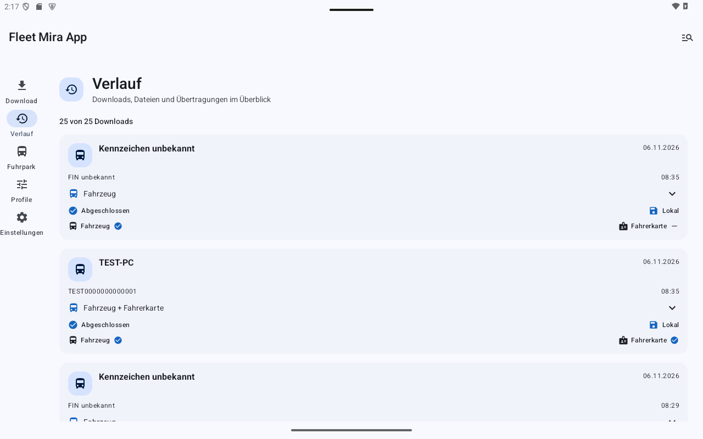
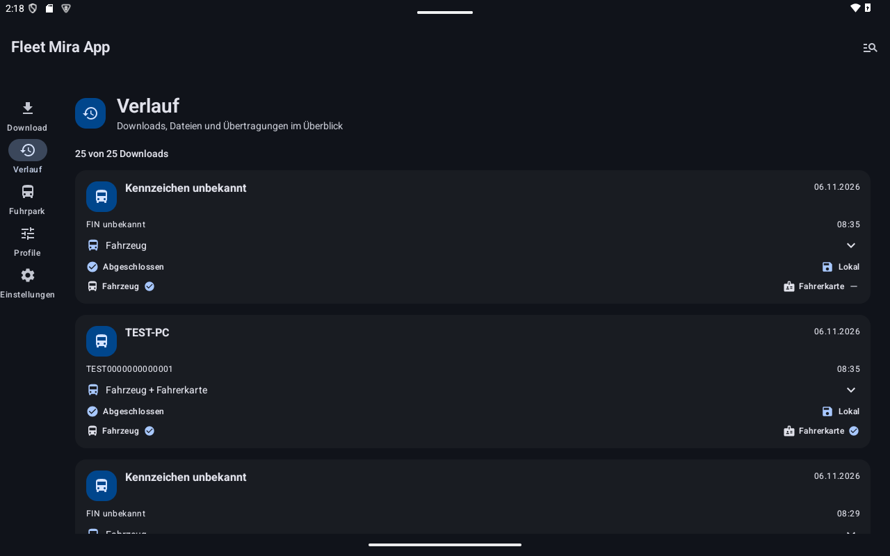

# Verlauf und Filter

**Verlauf** fasst lokale Downloadvorgänge und vorhandene Dateien zusammen. Die Karte zeigt Kennzeichen beziehungsweise Fahrer, Datum, FIN, Uhrzeit, Datenarten sowie Download- und Übertragungsstatus. Unbekannte Stammdaten bleiben unbekannt.

## Details und Originale

Tippen Sie einen Eintrag oder **Details anzeigen** an. Die aufgeklappte Ansicht enthält Profil, Datenarten, Fahrerangaben, Originaldateien und einzelne Übertragungen. **Fahrzeuginformation** unterscheidet den Stand des damaligen Downloads vom aktuellen Fahrzeugstand. Erneutes Antippen schließt die Details.

Für vollständige Dateien stehen **Exportieren**, **Senden** und gegebenenfalls **Dateien per E-Mail übergeben** zur Verfügung. Beim Zurückgehen bleibt der aufgeklappte Vorgang erhalten.

## Suchen und filtern

Das Symbol oben rechts öffnet **Suchen und filtern**. Durchsuchen Sie Kennzeichen, FIN, Vor-/Nachnamen und Fahrerkartennummer. Begrenzen Sie Datum, Datenarten, Übertragungswege, Downloadstatus und Serverübertragungsstatus. Mehrere Suchwörter müssen im selben Vorgang passen. Datumsgrenzen schließen beide Tage ein.

- **Anwenden:** Entwurf übernehmen; die Markierung am Symbol zeigt aktive Filter.
- **Abbrechen:** Änderungen des Entwurfs verwerfen.
- **Zurücksetzen:** Nur den Entwurf zurücksetzen; zum Übernehmen danach Anwenden wählen.

Die Auswahl bleibt bei Navigation und Drehung erhalten. Ein neuer App-Start beginnt mit der Standardauswahl. Die Trefferzahl unterscheidet fehlende Dateien von einem Filter ohne Treffer.

## Status lesen

| Anzeige | Bedeutung |
|---|---|
| **Abgeschlossen** beim Download | Lokaler Download vollständig |
| **Mit Einschränkungen / Fehlgeschlagen** | Hinweise und Dateiergebnis prüfen |
| **Lokal** | Kein Serverauftrag für diesen Vorgang |
| **Vorgemerkt / Wiederholung geplant** | Übertragung wartet oder wird erneut versucht |
| **Auf Server empfangen / Wird verarbeitet** | Empfang oder Verarbeitung, noch keine vollständige Fachbestätigung |
| **Archiviert / Ziel bestätigt** | Gegenstelle hat den entsprechenden Endzustand bestätigt |
| **Korrektur erforderlich** | Zugang, Ziel oder angezeigten Fehler prüfen |

Eine fehlgeschlagene Signaturprüfung ist kein erfolgreicher Echtheitsnachweis. Originaldateien bleiben unverändert. Suchdaten werden im Hintergrund ergänzt; das kann während USB-Sitzungen pausieren, ohne einen erfolgreichen Download nachträglich zum Fehler zu machen.

## Tablet-Ansichten

Die Aufnahmen im Tablet-Querformat zeigen synthetische Beispieldaten. Klicken oder tippen Sie auf ein Bild, um es in Originalgröße zu prüfen.

Die Übersicht trennt lokalen Downloadstatus und Übertragungsstatus; einzelne Vorgänge lassen sich aufklappen.

**Hell**

**Dunkel**

