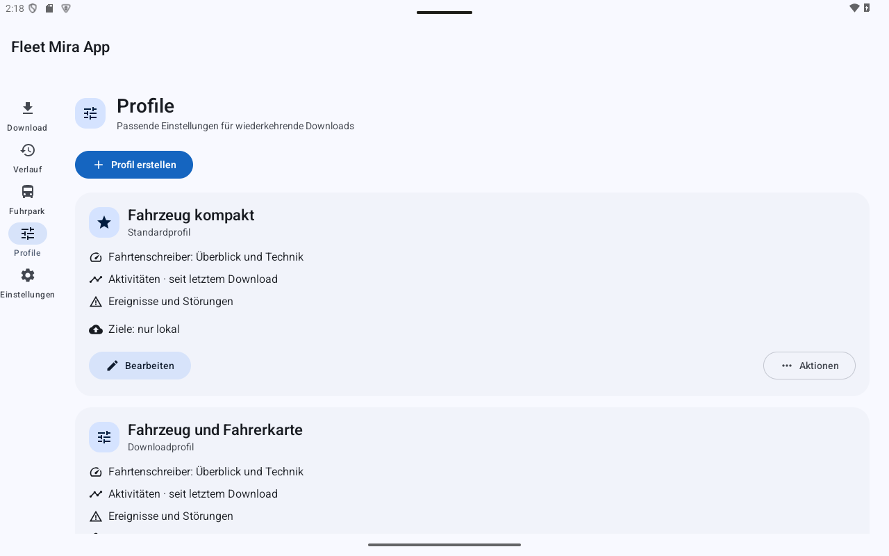
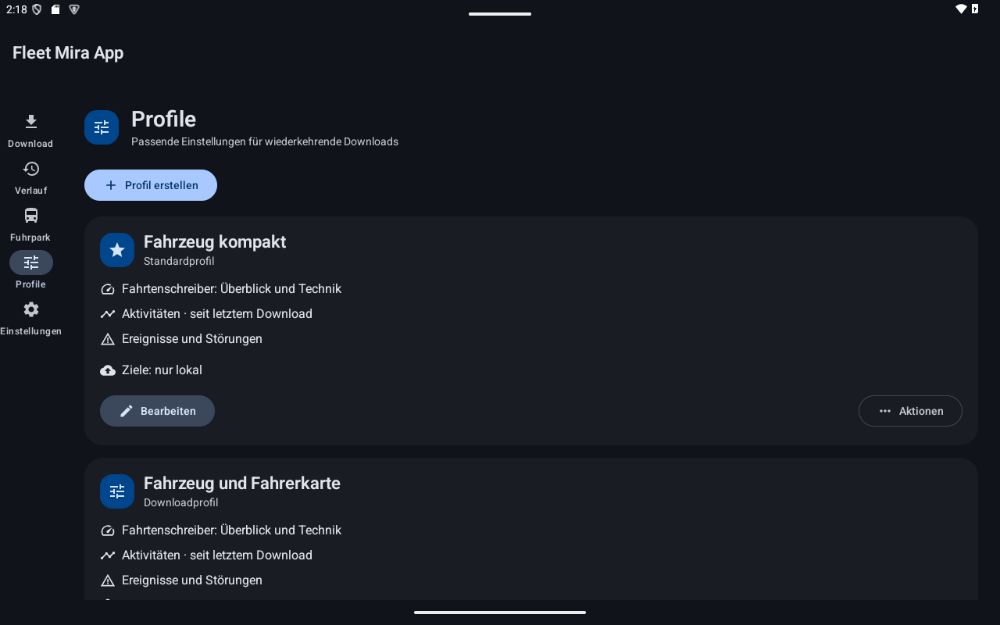

# Downloadprofile

Profile speichern Datenarten, Aktivitätszeitraum, optionale Fahrerkarte und Übertragungsziele. Ein Profil ist als Standard markiert und wird bevorzugt ausgewählt.

## Startprofile

| Profil | Verwendung |
|---|---|
| **Fahrzeug kompakt** | Kompakter Fahrzeugdownload |
| **Fahrzeug und Fahrerkarte** | Fahrzeug plus Fahrerkarte, standardmäßig Schacht 2 |
| **Vollständig** | Einschließlich genauer Geschwindigkeit und Fahrerkarte |

Prüfen Sie die angezeigte Zusammenfassung: Ein Profil kann nachträglich bearbeitet worden sein.

## Erstellen oder bearbeiten

Öffnen Sie **Profile → Profil erstellen** oder **Bearbeiten**. Vergeben Sie einen Namen und wählen Sie:

1. **Fahrzeug:** Aktivitäten, Ereignisse/Störungen und genaue Geschwindigkeit. Überblick und Technik werden ergänzend gelesen, soweit erlaubt.
2. **Fahrer:** Fahrerkarte und passender Kartenschacht.
3. **Aktivitätszeitraum:** **Seit letztem Download**, **Gesamter Zeitraum** oder **Zeitraum** mit Von/Bis.
4. **Download-Einstellungen:** optionale schnelle Baudrate und Standardauswahl.
5. **Übertragungsziele:** vorhandene Ziele oder nur lokale Speicherung.

**Speichern** übernimmt die Auswahl. Bis darf nicht vor Von liegen. **Seit letztem Download** verwendet die lokal nachgewiesene zusammenhängende Aktivitätsabdeckung dieser FIN mit Tagesüberlappung; reine Technik- oder Kartendownloads verschieben diese Grenze nicht.

## Weitere Aktionen

Unter **Aktionen** können Sie ein Profil **Duplizieren**, **Als Standard** setzen oder **Löschen**. Das aktuelle Standardprofil ist vor dem Löschen geschützt. Das Löschen anderer Profile löscht keine vorhandenen Downloads. Eine Profiländerung schreibt frühere Dateien und Empfangsbelege nicht um.

## Tablet-Ansichten

Die Aufnahmen im Tablet-Querformat zeigen synthetische Beispieldaten. Klicken oder tippen Sie auf ein Bild, um es in Originalgröße zu prüfen.

Profile zeigen Datenumfang und Standardmarkierung; weitere Befehle stehen unter Aktionen.

**Hell**

**Dunkel**

