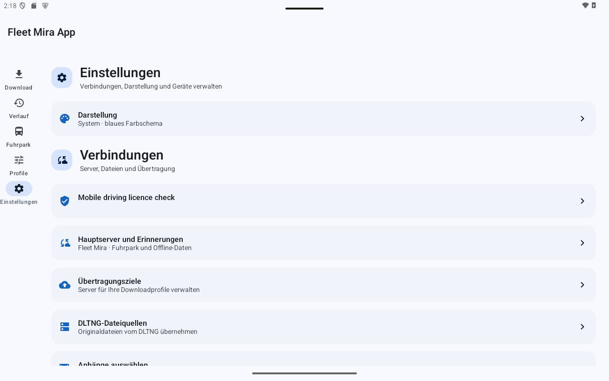
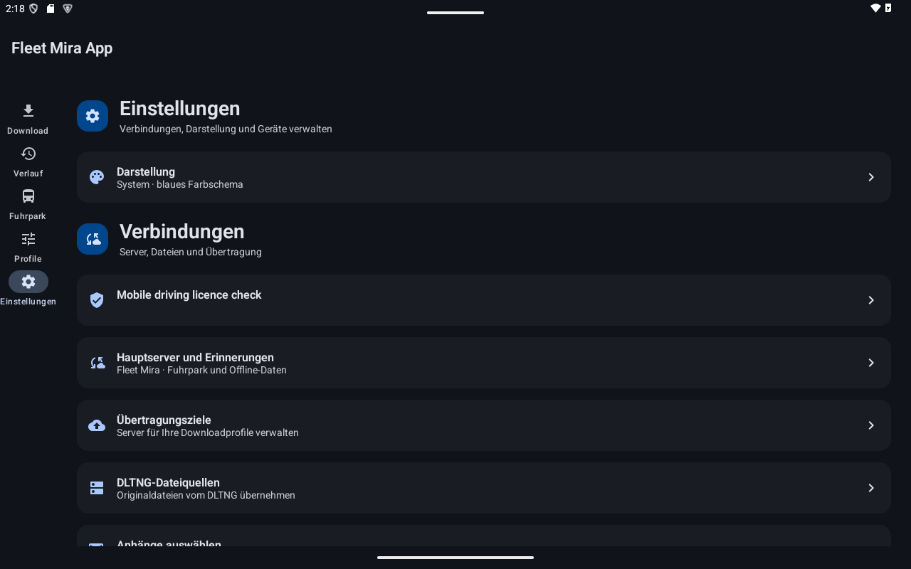

# Server und Einstellungen

Auf Smartphones heißt der Einstieg unten **Optionen**; die Seite selbst heißt **Einstellungen**. Darstellung, Verbindungen und Gerät/Support sind getrennt gruppiert.

## Übertragungsziel einrichten

1. Öffnen Sie **Übertragungsziele → Server hinzufügen**.
2. Vergeben Sie einen Namen und wählen Sie das passende Protokoll: Fleet Mira, DLTNG, FTPS, SFTP oder ausdrücklich FTP.
3. Übernehmen Sie Adresse, Port, Zielverzeichnis und Zugang exakt aus der vom Administrator bereitgestellten Konfiguration. Die benötigten Felder hängen vom Protokoll ab.
4. Legen Sie fest, ob Mobilfunk erlaubt ist; standardmäßig wird WLAN verwendet.
5. Speichern Sie das Ziel und wählen Sie es in den gewünschten [Profilen](profiles.md).

Für bereits verwendete Ziele können wesentliche Adress-/Protokolländerungen gesperrt sein, damit frühere Belege eindeutig bleiben. Legen Sie dann ein neues Ziel an. **Deaktivieren** verhindert die weitere reguläre Verwendung eines Ziels; prüfen Sie vorhandene Aufträge separat.

## Fleet Mira anmelden

Speichern Sie zunächst ein gültiges Fleet-Mira-Ziel mit einer HTTPS-Adresse. Über die Anmeldung öffnet sich ein geschütztes Browserfenster. Melden Sie sich dort an und kehren Sie über den angebotenen Rücksprung zur App zurück. Abgebrochene oder abgelaufene Anmeldungen starten Sie neu. Die App verwaltet und erneuert die zugehörigen Tokens automatisch. Ein manuell bereitgestelltes Integrationstoken kann bei entsprechender Serverkonfiguration separat verwendet werden.

Fahrtenschreiber-Uploads, Fuhrpark, Fahrerhistorie und Führerscheinkontrolle benötigen jeweils passende serverseitige Rechte. Die App kann diese nicht selbst erteilen. Für den Fuhrpark wählen Sie zusätzlich **Hauptserver und Erinnerungen**; siehe [Fuhrpark](fleet.md).

## Protokoll und Vertrauen

Fleet Mira benötigt HTTPS mit gültiger Zertifikatskette und passendem Servernamen. Für SFTP muss der erwartete Hostschlüssel durch Ihre IT geprüft werden. FTPS und SFTP schützen die Verbindung; einfaches FTP nicht.

DLTNG verwendet den Geräte-API-Schlüssel; dieser unterscheidet sich vom Fleet-Mira-Zugang. Der DLTNG-Standard ist HTTP auf Port 8888, optional HTTPS. Bei HTTP werden Schlüssel und Daten unverschlüsselt übertragen; wählen Sie Protokoll und Netz nach Ihrer betrieblichen Vorgabe. Ein Zertifikatsfehler wird nicht durch Abschalten der Prüfung oder automatischen Rückfall auf HTTP umgangen.

## Suche und Diagnose

**Geräte im Netzwerk** sucht nach DLTNG-/Fleet-Mira-Ankündigungen. Ein Suchtreffer ist ein Kandidat, kein Vertrauensnachweis; ältere Geräte werden eventuell nicht angekündigt. Manuelle Einrichtung bleibt möglich.

Unter **Diagnose** stehen App-Version, Protokollmeldungen und ein optionaler Byte-Trace für den nächsten Download. Traces können Originalnutzdaten enthalten. Aktivieren und teilen Sie diese nur gezielt nach [Datenschutz und Speicherung](privacy.md).

## Tablet-Ansichten

Die Aufnahmen im Tablet-Querformat zeigen synthetische Beispieldaten. Klicken oder tippen Sie auf ein Bild, um es in Originalgröße zu prüfen.

Beschriftete Gruppen führen zu Darstellung, Verbindungen und Supportfunktionen.

**Hell**

**Dunkel**

